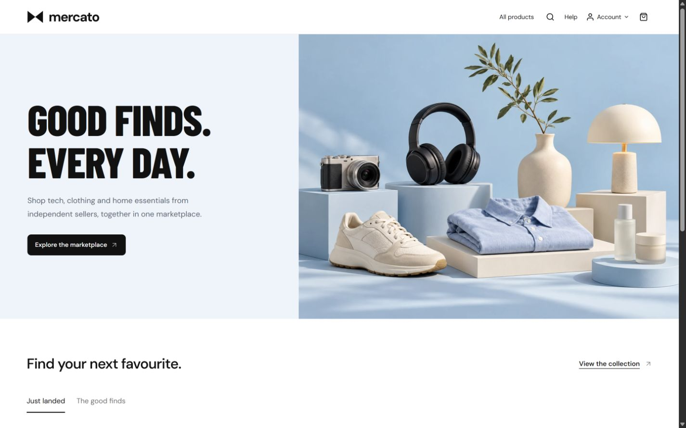
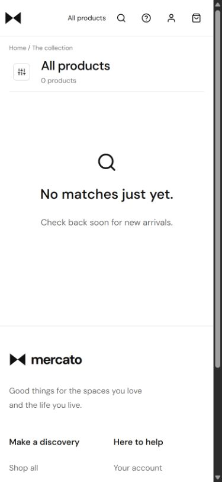
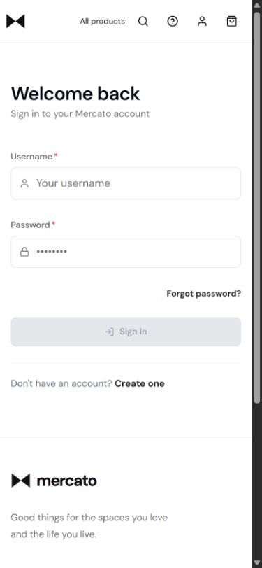

# Beta fresh-launch deployment — 25 October 2026

## Installed release and isolation

- Site: https://mercato-in-beta.netlify.app; Netlify project `02941023-e0ec-44f6-a289-4680a89b46a9`.
- Backend prerelease: [v0.1.0-beta.1](https://github.com/saikat-ghosh-in/mercato/releases/tag/v0.1.0-beta.1), built from main `441b35a7786fd7db4a78520307d82501fed5bdcd`.
- Installed JAR SHA-256: `21e87745d720276aa8d585e22867cb63d2b7df0adad336f31b3c3e5e96425d75`, matched against the release manifest and GitHub asset digest before installation.
- The frontend starts from that release, with staging follow-ups: `99cff3f95518ee45ca435d957f379ee730bc2d60` fixes the Netlify plugin loader contract, and `1a2a5e4` moves the campaign image out of the forced backend `/images` proxy namespace into Vite's hashed `/assets` output. Both defects were reproduced with failing regression tests before their fixes. Backend release bytes are unchanged.
- Service/runtime user: `mercato-beta`; application `/opt/mercato-beta`; private HTTP listener `127.0.0.1:8081`.
- Fresh PostgreSQL database `mercato_beta_launch`, separate owner/runtime roles and all seven Flyway migrations successful. Runtime audit/history permissions restricted after migration; OSIV remains disabled.
- Existing Nginx/Let's Encrypt retained, editing only the beta virtual host. No Caddy installation or production listener replacement. This is a beta-specific adaptation of the original ingress plan; a later Caddy/production migration remains a separate change.
- Beta signing secret is marked secret and limited to the beta site's published (`production`) deploy context. The plan's supported secret scopes are Builds, Functions and Runtime; Post processing and other contexts do not receive this secret. Production Netlify configuration was not changed.
- Production service PID, JAR digest and Nginx site-file digest were unchanged across installation; production storefront returned `200`. No production database, account, upload, release or shared database role was removed.

## Executed verification

- [Release workflow](https://github.com/saikat-ghosh-in/mercato/actions/runs/40167909899): frontend, PostgreSQL/backend, Linux operations, Java advisory assessment and artifact upload all passed.
- [Final application checks](https://github.com/saikat-ghosh-in/mercato/actions/runs/40170297293) on `1a2a5e4`: all four application-check jobs passed, including PostgreSQL/backend, operations and dependency assessment. Local frontend checks: **79 tests passed**, lint passed and production build passed. Vite retains the existing large-main-chunk advisory.
- [Published Netlify deploy](https://app.netlify.com/projects/mercato-in-beta/deploys/6adda5c4be2cd6add2ccd503): root configuration, signed rewrites, security-header plugin and Edge Function deployed. Initial failed builds did not publish; plugin lifecycle and supported variable-scope issues were corrected before publication. The final banner loaded at natural width 1448 from `/assets/marketplace-campaign-CwXGDcRF.webp`; the fresh Browser document had no warning/error logs.
- Anonymous session JSON through real Netlify HTTPS returned `200` in 0.535 seconds, with private responses marked `no-store`.
- Session cookie verified Secure, HttpOnly, host-only and SameSite=Lax. A valid admin password without CSRF was rejected (`401`); sign-in with CSRF rotated the session/account context and returned `ENROLL_REQUIRED`, without administrator privileges.
- Protected administration returned `401` before MFA; stale account-context mutation returned `409 SESSION_CONTEXT_CHANGED`. The temporary pending-MFA test session was signed out. No authenticator seed or recovery codes were enrolled on the owner's behalf.
- Unsigned direct beta-origin API call returned `403`. A request carrying forged forwarding, Mercato and Netlify signature metadata still reached the legitimate anonymous bootstrap through Edge normalization.
- A correctly signed, deliberately malformed UTF-8/CRLF webhook body reached payload validation (`400 Invalid webhook payload`, 0.588 seconds); changing one byte with the same signature produced `400 Invalid webhook signature` (0.485 seconds). This proves raw-byte preservation through the deployed proxy without creating a gateway event or job. It does **not** measure durable acknowledgment for a real successful payment event.
- Final database check: seven successful migrations, empty gateway inbox, no durable jobs or needs-attention records. Fresh public catalog returned zero products.
- Browser: desktop 1440px home; 390px catalog/filter drawer, invalid-price validation, Cancel discarding edits, custom sort/Apply URL updates and focus return; sticky header at scrollY 245 retained All products, search, Help and Account access. No horizontal overflow at those tested widths.
- Browser: 320px login and seller registration toggle/fields had no horizontal overflow. Login, shopper/seller registration and empty catalog rendered from the deployed HTTPS origin. No registration, purchase or email was submitted in Browser.
- Enforced static CSP observed with no wildcard/inline/eval script allowance, plus nosniff, DENY framing and strict-origin-when-cross-origin referrer policy. The Netlify-hosted response returned provider HSTS `max-age=31536000; includeSubDomains; preload` despite the configured 300-second value; beta origin Nginx requests 300 seconds. No custom-domain preload was requested.

## Cleanup performed

The disconnected **old `mercato_beta` database** was dropped after checking there were no connections. The new `mercato_beta_launch` database remains active. Removed only the four temporary legacy beta backups made during installation: environment, unit, Nginx site and old JAR. The active JAR, new environment, current release/checksum and new uploads remain.

The shared `mercato-admin` database role and all production resources remain. No beta upload purge was necessary: the old inventory contained no beta upload files. The beta redeploy wrapper explicitly fixes the app directory, service and site; its syntax and the downloaded installer syntax passed. The beta-only cookie-cutover marker was created after the deployed authentication checks.

The actual command `bash ~/redeploy-beta.sh v0.1.0-beta.1` was then rerun successfully against the same immutable release: checksum OK, same-tag retry accepted, only beta restarted, and the Netlify session-readiness check passed. This validates the normal future-update path beyond the first manual installation.

## First login and remaining acceptance

The owner-only first-admin credential handover file is `~/mercato-beta-first-admin.txt` on OCI (mode `0600`). The backend environment is root-only `0600`. Read the handover privately over SSH, sign in at `/login`, enroll an authenticator and save recovery codes. The account already exists; public registration cannot create administrators. Do not regenerate the MFA encryption key on redeploy.

After enrollment, create categories/products and inventory in Administration. The fresh launch intentionally contains no demo catalog or historical accounts/orders.

Still to exercise with real configured services and owner access: administrator/seller business actions after MFA, delivered Brevo verification/reset mail, configured Cashfree sandbox order/capture/cancellation/refund flows and gateway-dashboard webhook/domain settings. Existing beta sandbox/SMTP credentials were carried forward privately, but successful delivery/financial settlement has not been claimed. Live payments remain off. Deployed IPv6/duplicate-header probes, deliberate Edge crash testing, full commerce acceptance and real-phone testing remain in the acceptance runbooks.

Automatic off-instance backups and external dead-man alerts remain unconfigured; no paid resources were provisioned. Beta availability is not production-release approval. Production deployment/cleanup and promotion of staging follow-up fixes to main require the later production step.

## Browser evidence

